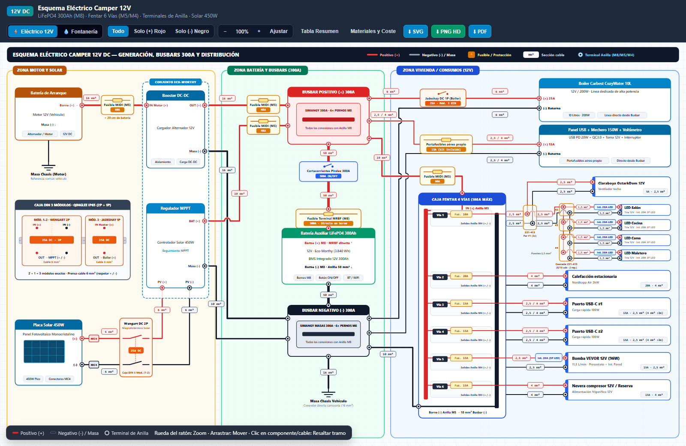
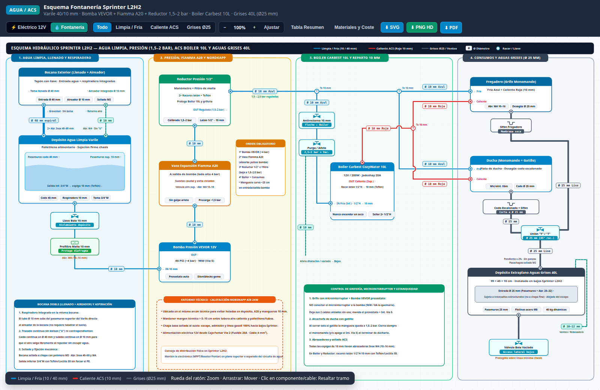
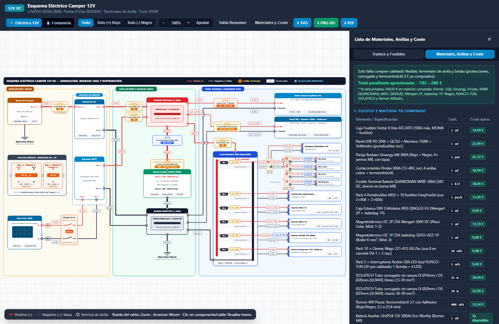

# Esquemas Camper Mercedes-Benz Sprinter L2H2 — Electricidad 12V y Fontanería

Proyecto interactivo (`HTML` + `SVG`) y dossiers imprimibles en PDF para diseñar, verificar y llevar al taller el montaje **eléctrico 12V** y de **fontanería / ACS** de una furgoneta camper gran volumen (**Mercedes-Benz Sprinter L2H2**).

> 🌐 **Web interactiva en GitHub Pages:**
> - **Abrir aplicación:** https://endermejia.github.io/camper-electricidad-fontaneria/
> - **Directo a ⚡ Eléctrico 12V:** https://endermejia.github.io/camper-electricidad-fontaneria/#electrico
> - **Directo a 💧 Fontanería:** https://endermejia.github.io/camper-electricidad-fontaneria/#fontaneria

---

## 1. Esquema Eléctrico 12V DC (`LiFePO4 300Ah + Solar 450W`)



### Arquitectura eléctrica implementada
- **Generación y carga:**
  - Alternador / Batería de arranque → cable `16 mm²` + **Fusible MIDI 60A** (`< 20 cm`) → **Booster DC-DC Eco-Worthy** → **MIDI 40A** → Busbar (+).
  - **Placa Solar 450W** (`MC4`) → **Magnetotérmico DC Bipolar 2P 25A (Wengart)** (`6 mm²`, módulos 1–2 de caja estanca **QINGLEE 3 módulos**) → **Regulador MPPT Eco-Worthy** → **MIDI 40A** (`10 mm²`) → Busbar (+).
- **Batería y distribución de potencia (`300A`):**
  - **Batería Auxiliar LiFePO4 12V 300Ah Eco-Worthy (bornes M8)** con **Fusible Terminal MRBF 300A (QUARKZMAN)** atornillado directo en borne `+` M8 → `50 mm²` → **Cortacorrientes rotativo Pindex 300A** → **Busbars Simangy 300A (`6 × pernos M8`)**.
  - Puesta a masa chasis en `16 mm²` desde el Busbar Negativo (-).
- **Consumos 12V:**
  - **Línea dedicada Boiler Carbest CozyWater 10L (`12V / 200W`):** `6 mm²` directo desde Busbars con **Magnetotérmico DC 1P 25A (Jadeshay)** en módulo 3 de la misma caja DIN.
  - **Línea dedicada Panel USB PD + QC3.0 + Mechero 150W + Voltímetro:** `2,5 / 4 mm²` con portafusibles aéreo propio de `15A`.
  - **Caja de Fusibles Fentar 6 Vías (`100A máx`, entrada M5 con MIDI 60A, salidas M4):**
    - **Vía 1 (`10A`, `2,5 mm²`):** `Claraboya OstarkDom 12V` + **4 zonas LED independientes** (`Salón`, `Cocina`, `Cama`, `Maletero`, `1,5 mm²`) repartidas en cascada mediante **4 pares de `Wago 221-413`** e interruptores **RUNCCI-YUN 20A (3 pines LED azul)**.
    - **Vía 2 (`20A`, `4 mm²`):** `Calefacción estacionaria Nordkapp Air 2kW`.
    - **Vías 3 y 4 (`15A`, `2,5 / 4 mm²`):** `2 × Puertos USB-C 100W`.
    - **Vía 5 (`15A`, `2,5 mm²`):** `Bomba a presión VEVOR 12V (96W · presostato)` + interruptor de corte en pared `20A 3P LED`.
    - **Vía 6 (`15A`, `4 mm²`):** `Nevera compresor 12V / Reserva`.

---

## 2. Esquema de Fontanería (`Agua Limpia, Presión, ACS 10L y Grises 40L`)



### Circuitos hidráulicos y decisiones clave
1. **Agua limpia y llenado (`Depósito Varile`):**
   - Llenado por gravedad desde bocana exterior doble (entrada + aireador integrado) con manguera espiral **`Ø 40 mm`** (abrazaderas inox `40–60 mm`) y pasamuros en codo.
   - Respiradero superior **`Ø 10 mm`** desde el pasamuros superior del depósito conectado de vuelta al **aireador integrado de la propia bocana** en ascenso continuo (sin bolsas "U" ni perforación adicional en el suelo).
   - Aspiración inferior **`3/4"M → 10 mm`** → **llave de paso de bola** → **prefiltro transparente de malla** antes de la bomba.
2. **Sistema de presión y regulación (orden crítico):**
   - **Bomba VEVOR (`60 PSI / ~4 bar`, `96W`)** sobre silentblocks → **Vaso de expansión Fiamma A20** (siempre en el lado de alta presión a la salida inmediata de la bomba) → **Reductor de presión `1/2"` con manómetro y filtro de malla** calibrado entre **`1,5 y 2,0 bar`**.
3. **ACS (`Boiler Carbest CozyWater 10L`) y entorno térmico (`Nordkapp Air`):**
   - Racores de latón `1/2"H → 10 mm` con teflón/Loctite 55, **válvula antirretorno `Ø 10 mm`** (flecha hacia el boiler, siempre aguas arriba) + **válvula de alivio/purga (`2,5–3 bar`)** por dilatación térmica y vaciado anti-heladas.
   - Distribución con **Tes `Ø 10 mm`** y manguera alimentaria **azul (fría)** / **roja (caliente)** + abrazaderas **inox W4 (`10–16 mm`)**.
   - Control de grifería: al usar bomba VEVOR por presostato, **el microinterruptor del grifo queda sin conectar** (control desde interruptor de pared Vía 5).
4. **Aguas grises (`Ø 25 mm` → Depósito extraplano `40 L` `99×40×10 cm`):**
   - Desagüe de plato de ducha (codo escalonado) y fregadero con **sifones de membrana seca**, tubería flexible **`Ø 25 mm` de interior liso**, unión en **"Y" (`45°`)** con pendiente continua `≥ 2%`, venteo/rebosadero en depósito de bajos y llave de vaciado de bola.

---

## 3. Panel Interactivo, Lista de Cables y Dossiers PDF para Taller



Desde la barra superior puedes:
- **Cambiar entre planos** (`⚡ Eléctrico 12V` ↔ `💧 Fontanería`) y filtrar por circuito/polaridad (`Solo (+) Rojo`, `Solo (-) Negro`, `Limpia / Fría`, `Caliente ACS`, `Grises Ø25`).
- **Hacer zoom y paneo** (`rueda + arrastrar`) o pulsar cualquier componente/cable para resaltar su tramo completo.
- **Consultar las tablas del cajón lateral** (`Tabla Resumen` y `Materiales y Coste`).
- **Exportar o imprimir:** descarga directa en **`SVG`**, **`PNG HD`** (`4720 × 2760 px`) o abrir los dossiers PDF listos para taller:
  - 📄 [**Dossier Eléctrico PDF (6 páginas)**](esquema-electrico-camper-12v.pdf): plano completo + resumen de protecciones + lista de cables rojos/negros para crimpar + tabla exacta de **52 terminales de anilla** + presupuesto.
  - 📄 [**Dossier Fontanería PDF (3 páginas)**](esquema-fontaneria-camper.pdf): plano hidráulico + orden lógico de montaje en 12 pasos + despiece de mangueras/racores/abrazaderas + protocolo de prueba de estanqueidad.

---

## Estructura del repositorio

```text
├── index.html                        # Visor web interactivo dual (Eléctrico 12V / Fontanería)
├── styles.css                        # Estilos de barra, rejilla técnica, filtros y panel lateral
├── svg-utils.js                      # Utilidades SVG compartidas (cables, saltos, tarjetas, zonas)
├── app.js                            # Esquema eléctrico 12V, tablas, BOM e interactividad dual
├── plumbing.js                       # Esquema hidráulico Sprinter L2H2 y tablas de fontanería
├── dossier-impresion.html            # Plantilla imprimible A4 apaisada (Eléctrico)
├── dossier-fontaneria.html           # Plantilla imprimible A4 apaisada (Fontanería)
├── esquema-electrico-camper-12v.pdf  # Dossier eléctrico listo para imprimir (6 páginas)
├── esquema-fontaneria-camper.pdf     # Dossier fontanería listo para imprimir (3 páginas)
└── docs/                             # Capturas de vista previa para documentación
```

## Uso en local y adaptación

Clona el repositorio y levanta cualquier servidor HTTP estático (por ejemplo Python):

```bash
git clone https://github.com/endermejia/camper-electricidad-fontaneria.git
cd camper-electricidad-fontaneria
python -m http.server 8123 --bind 127.0.0.1
```

Abre `http://127.0.0.1:8123/` en tu navegador. Si quieres adaptarlo a tu propia furgoneta, los componentes, secciones y tablas están definidos en JavaScript puro dentro de [app.js](app.js) y [plumbing.js](plumbing.js).
